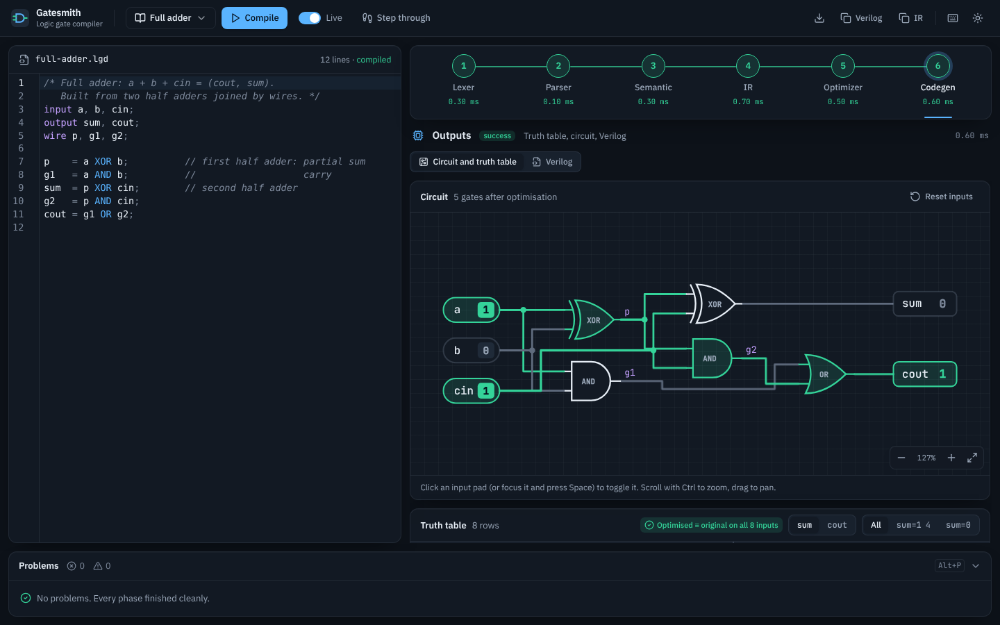
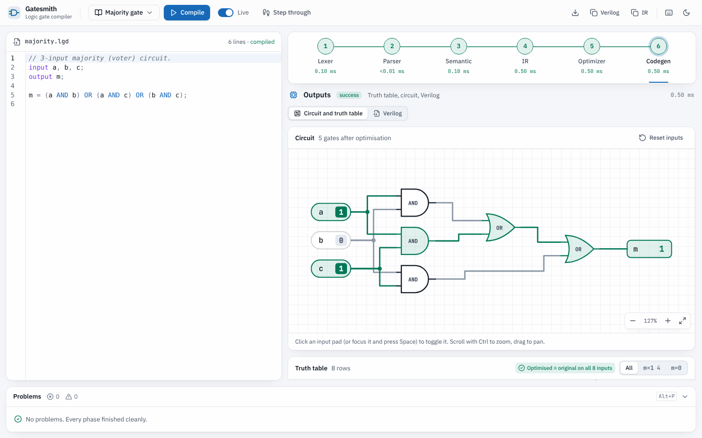
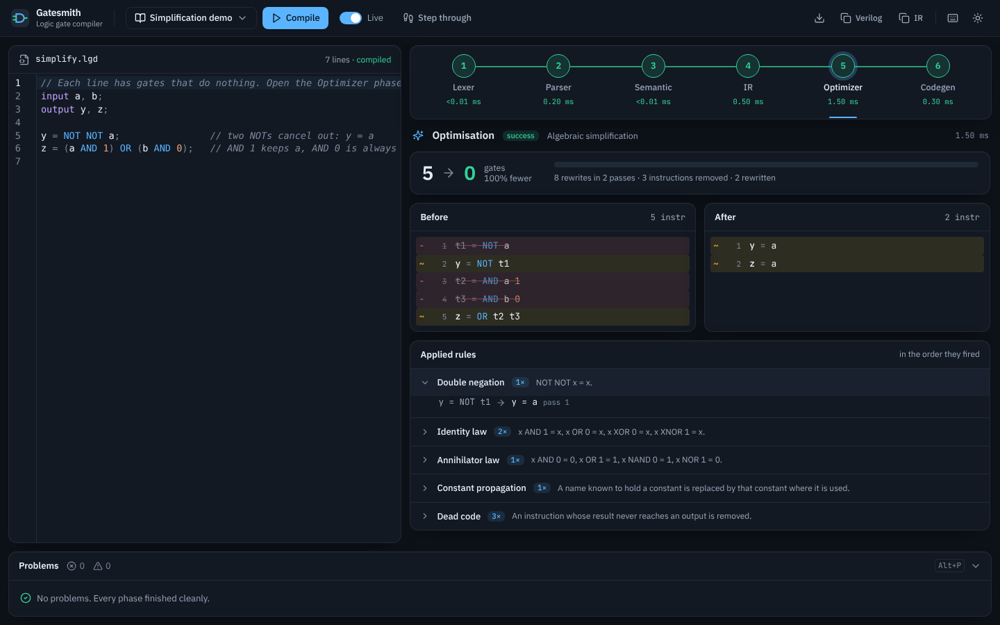
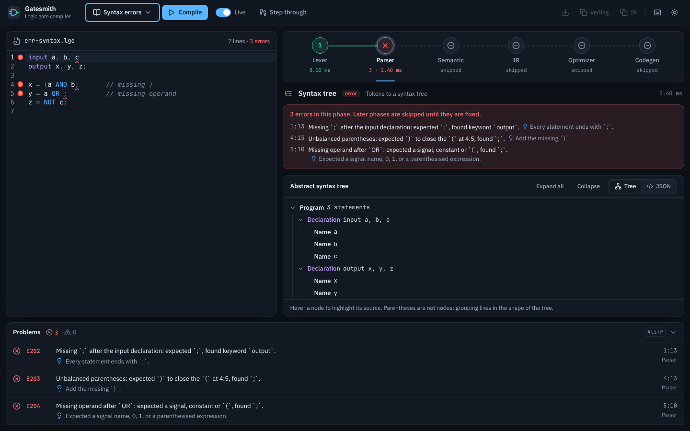
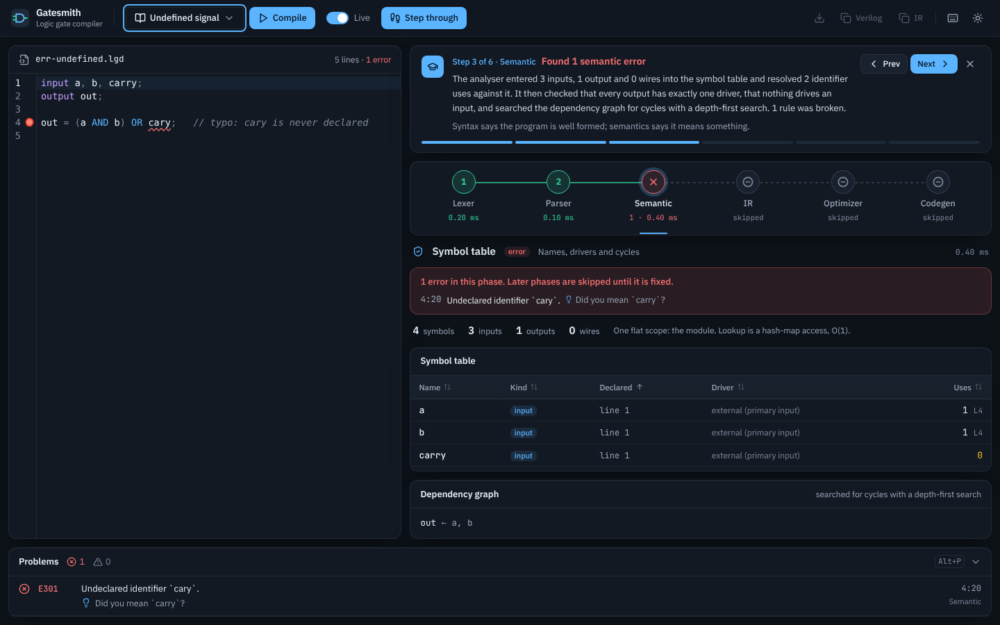
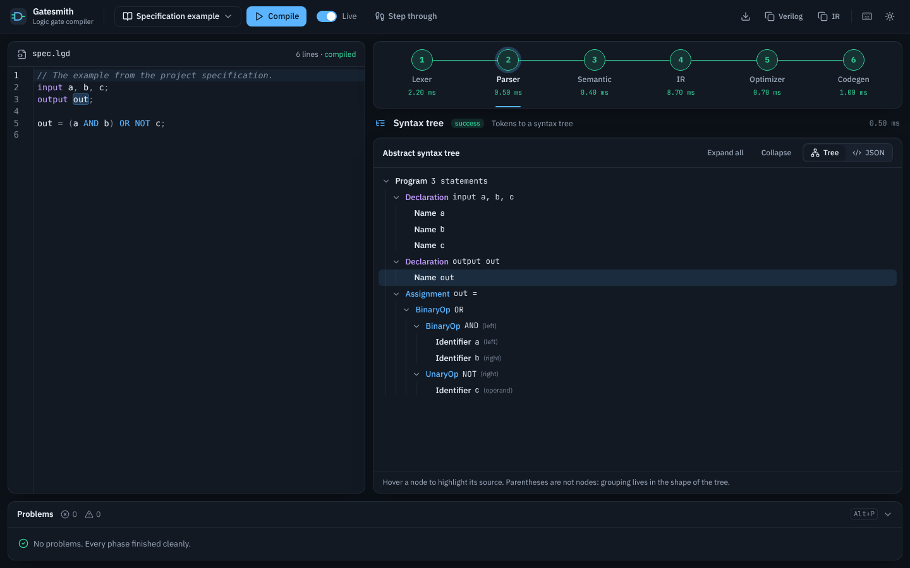
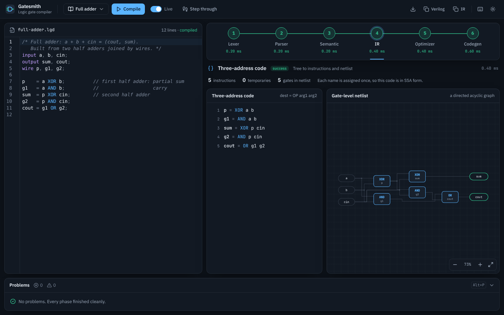

# Gatesmith: a logic gate description compiler

Gatesmith is a complete compiler for a small hardware-description language for combinational logic. You type a circuit, and every compiler phase updates live beside the editor: tokens, syntax tree, symbol table, three-address code, optimisation, and finally three targets. Those targets are a **truth table**, an **interactive circuit diagram (SVG)** and a **Verilog module**.

```text
input a, b, c;
output out;
out = (a AND b) OR NOT c;
```

The compiler (lexer, recursive-descent parser, semantic analyser, IR generator, optimiser and code generators) is about 2,700 lines of hand-written TypeScript in `src/compiler/`, with **zero dependencies** and no parser generator. It runs fully in the browser; there is no backend.



## Features

**Compiler**
- Hand-written lexer with line/column tracking and error recovery. It reports invalid characters, unterminated `/* */` comments, a stray `*/`, and bad constants, then keeps scanning.
- Recursive-descent parser in which each grammar rule is one method. Precedence is NOT > AND/NAND > XOR/XNOR > OR/NOR, all binary operators are left-associative, and panic-mode recovery lets one run report every syntax error, each as "expected X, found Y".
- Semantic analysis with a symbol table and 11 coded diagnostics (E301–E308, W301–W303). Cycles are found by depth-first search, and suggestions come from edit distance, e.g. "did you mean `carry`?".
- Three-address code (already in SSA form) and a gate-level netlist DAG.
- An optimiser with 14 logged rules: constant folding and propagation, identity/annihilator/inversion laws, idempotence, complement law, double negation, inverter absorption, common-subexpression elimination, copy propagation and coalescing, and dead-code elimination. It shows gate counts before and after, plus a line diff.
- Code generation:
  - A truth table with minterms, canonical SOP and minimal SOP (Quine–McCluskey). The optimised and unoptimised circuits are checked for equivalence on every input.
  - A circuit SVG from a hand-written layered layout: dummy nodes, barycentre crossing reduction, isotonic placement, orthogonal channel routing, and junction dots.
  - Synthesisable Verilog.
- The compiler never throws. Every phase is wrapped, so an internal bug becomes an `E900` diagnostic instead of a crash, and this is fuzzed with 3,000 random inputs.

**Interface**
- CodeMirror 6 editor highlighted by the compiler's own lexer, with inline error and warning underlines and gutter markers.
- Pipeline stepper (Lexer → Parser → Semantic → IR → Optimizer → Codegen) with status badges and per-phase timing. When an earlier phase fails, later phases show as *skipped*.
- Hover any token, AST node, symbol, IR line or gate to highlight its source; click to select it.
- Live circuit: click an input pad, and the new values ripple through the gates layer by layer, green for 1 and grey for 0. Hovering a truth-table row previews it on the circuit.
- **Step-through mode** for demos: Next and Prev walk the phases, each with a plain-English explanation of what that phase just did *to your program*.
- Problems panel with code, message, line:col and suggestion; clicking a problem jumps to it.
- 19 bundled examples: all seven basic gates, six classic circuits, a simplification demo and five error demos. Also dark and light themes, keyboard shortcuts, responsive layout, and WCAG AA text contrast.
- Exports: download the SVG, copy Verilog, copy IR, download `circuit.v`.

| | |
|---|---|
|  |  |
| Light theme, majority gate | Optimizer: 5 gates down to 0 |
|  |  |
| Three syntax errors reported in one run | Step-through mode explaining a semantic error |
|  |  |
| AST with source highlighting | Three-address code and netlist DAG |

## Quick start

Requires Node.js 18 or newer (developed on Node 22).

```bash
npm install
npm run dev        # start the dev server, then open the printed URL
npm test           # 97 Vitest tests
npm run build      # type-check and build to dist/
npm run lint       # ESLint
npm run typecheck  # tsc --noEmit for app and config
```

**Prebuilt version.** `dist/` is included and works from any static server, because it is built with `base: './'`:

```bash
npx serve dist        # or: python3 -m http.server 8080 --directory dist
```

Opening `dist/index.html` directly from the file system will not work, because browsers block ES modules on `file://` URLs. Use a static server.

**Browser smoke test (optional).** This needs Python and Playwright with Chromium (`pip install playwright && playwright install chromium`):

```bash
npm run build
python3 -m http.server 4173 --directory dist &
npx vite-node scripts/dump-examples.ts /tmp/examples.json
CHROME=$(python3 -c "from playwright.sync_api import sync_playwright as p; print(p().start().chromium.executable_path)") \
  python3 scripts/smoke_test.py http://localhost:4173/ /tmp/examples.json
```

It loads all 19 examples through the real UI and exercises toggling, step-through, live errors, the 10-input cap, the theme and shortcuts: 49 checks in total.

## Keyboard shortcuts

| Keys | Action |
|---|---|
| Ctrl/⌘ + Enter | Compile now |
| Alt + 1…6 | Open a phase |
| Alt + S | Step-through mode |
| Alt + ← / → | Previous / next phase |
| Alt + P | Toggle the Problems panel |
| Alt + T | Toggle the theme |
| Ctrl + wheel, drag | Zoom and pan the circuit |
| Space / Enter | Toggle a focused circuit input |
| ? | Show all shortcuts |

## Project structure

```text
src/
  compiler/            the compiler, pure TypeScript, zero dependencies
    errors.ts          Diagnostic type, error-code catalogue, edit distance
    lexer.ts           phase 1: characters → tokens
    ast.ts             AST node types and pretty-printer
    parser.ts          phase 2: recursive descent, panic-mode recovery
    symbols.ts         symbol table
    semantic.ts        phase 3: name resolution, drivers, cycles, warnings
    ir.ts              phase 4: three-address code, interpreter, netlist DAG
    optimizer.ts       phase 5: rewrite rules to a fixpoint, dead-code elimination
    codegen.ts         phase 6: truth table, Quine–McCluskey, Verilog
    circuit.ts         phase 6: layered auto-layout and SVG
    pipeline.ts        runs the phases, timing, error gating, never throws
  components/          React UI: editor, stepper, problems panel, phase views
  components/ui/       shadcn/ui-style primitives (Radix + Tailwind)
  examples/            19 bundled example programs, with expected diagnostics
  lib/                 explanations for step-through, theme, toast, helpers
tests/                 Vitest suites: lexer, parser, semantic, optimizer, codegen, examples, fuzz
scripts/               browser smoke test, screenshot and guide-data generators
docs/                  screenshots, architecture diagram, generated guide data
GUIDE.md / GUIDE.pdf   the project report
TEAM_SCRIPTS.md / .pdf  simple speaking scripts for a four-person presentation
```

## Language grammar (EBNF)

```ebnf
program     = { statement } EOF ;
statement   = declaration | assignment | ";" ;
declaration = ( "input" | "output" | "wire" ) IDENT { "," IDENT } ";" ;
assignment  = IDENT "=" expr ";" ;

expr        = orExpr ;
orExpr      = xorExpr { ( "OR"  | "NOR"  | "|" ) xorExpr } ;      (* lowest precedence *)
xorExpr     = andExpr { ( "XOR" | "XNOR" | "^" ) andExpr } ;
andExpr     = unary   { ( "AND" | "NAND" | "&" ) unary } ;
unary       = ( "NOT" | "!" | "~" ) unary | primary ;            (* highest precedence *)
primary     = IDENT | CONST | "(" expr ")" ;

IDENT       = letter { letter | digit } ;          (* letter includes "_"; case-sensitive *)
CONST       = "0" | "1" | "true" | "false" ;
comment     = "//" { any-but-newline } | "/*" { any } "*/" ;
```

Keywords and operator words are case-insensitive (`and`, `AND` and `And` are the same). Identifiers are case-sensitive.

## Example walkthrough

For `out = (a AND b) OR NOT c;`:

1. **Lexer** produces 21 tokens: `INPUT a , b , c ; OUTPUT out ; out = ( a AND b ) OR NOT c ;` and then `EOF`.
2. **Parser** builds `Assignment(out, Binary(OR, Binary(AND, a, b), Unary(NOT, c)))`. The parentheses disappear, because grouping is the tree's shape.
3. **Semantic** analysis enters `a`, `b` and `c` (inputs) and `out` (output) into the symbol table. `out` has exactly one driver and no cycles.
4. **IR** emits `t1 = AND a b`, `t2 = NOT c`, `out = OR t1 t2`.
5. **Optimizer** makes no change: no rule applies, so all 3 gates remain.
6. **Codegen** produces the truth table `out = Σm(0, 2, 4, 6, 7)`, with minimal SOP `NOT c OR (a AND b)`, a 3-gate circuit, and `assign out = (a & b) | ~c;`.

Load *Simplification demo* from the examples menu to see 5 gates reduced to 0, with every rewrite listed.

See **GUIDE.md** for the full report: the theory behind each phase, design decisions, proofs of the optimiser rules, the edge-case table and viva preparation.
